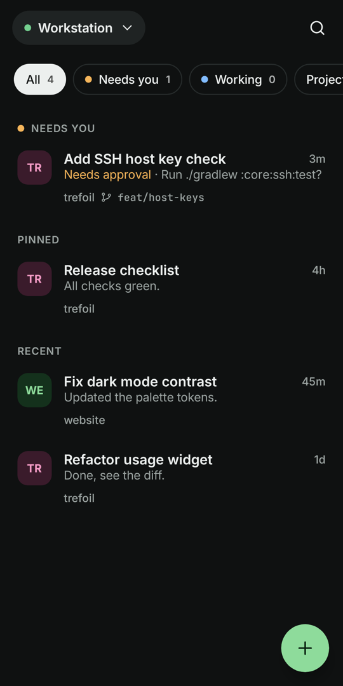
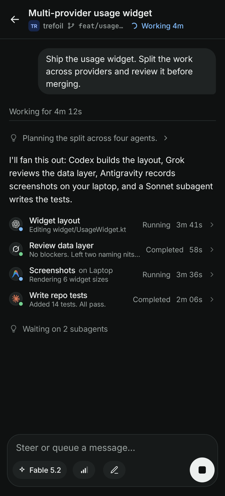
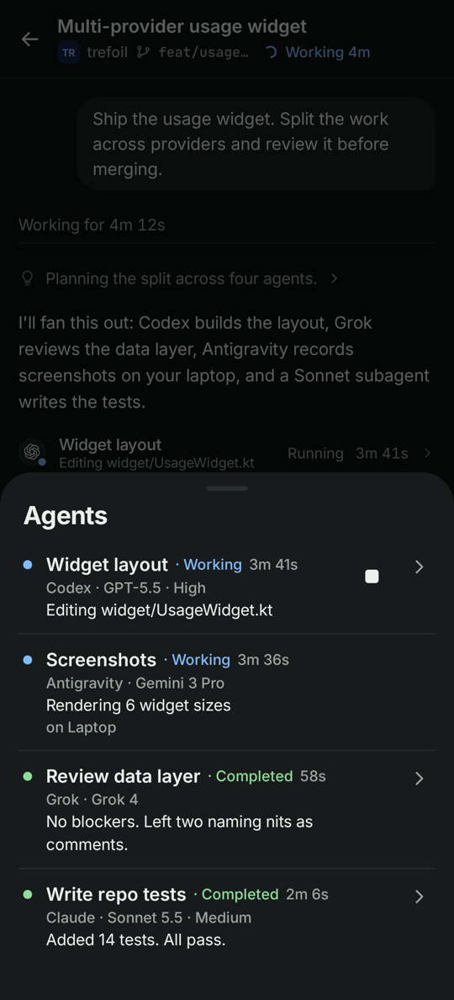
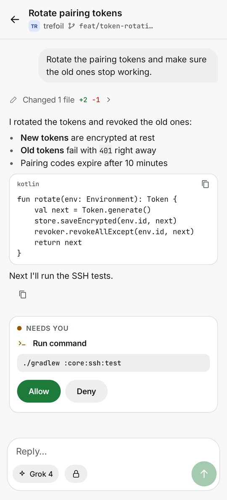
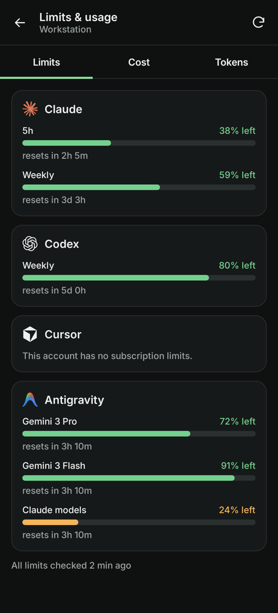
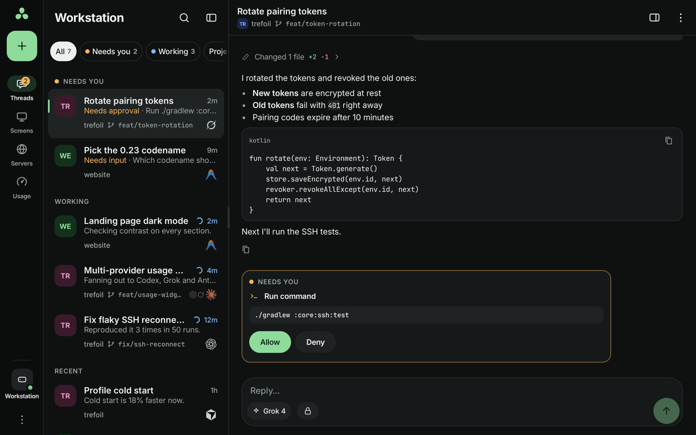
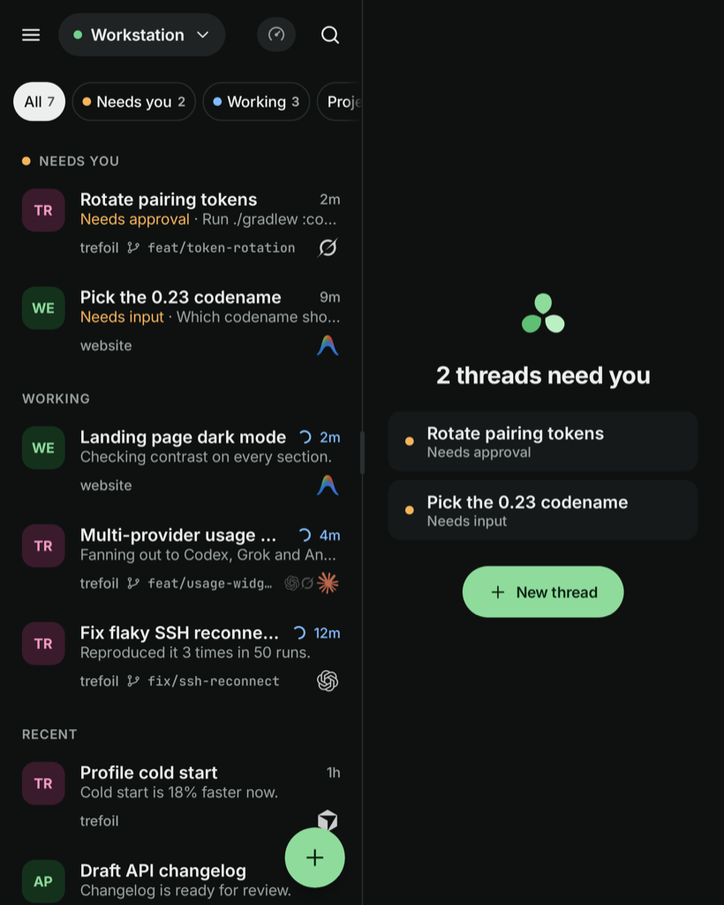

<div align="center">

# ☘️ Trefoil

### T3 Code, within reach.

A native Android client for [T3 Code](https://github.com/pingdotgg/t3code): check on your agents, answer approvals and keep threads moving from your phone.

[](https://github.com/tajchert/trefoil/releases/latest)


[](LICENSE)

**[⬇️ Download the APK](https://github.com/tajchert/trefoil/releases/latest)** · [Release notes](https://github.com/tajchert/trefoil/releases) · [Implementation status](docs/IMPLEMENTATION_STATUS.md)

<br>

<table>
  <tr>
    <td align="center"></td>
    <td align="center"></td>
    <td align="center"></td>
  </tr>
  <tr>
    <td align="center"><sub><b>Every provider, one list</b></sub></td>
    <td align="center"><sub><b>Fable orchestrating subagents</b></sub></td>
    <td align="center"><sub><b>Agents across providers</b></sub></td>
  </tr>
</table>

<table>
  <tr>
    <td align="center"></td>
    <td align="center"></td>
  </tr>
  <tr>
    <td align="center"><sub><b>Approvals</b></sub></td>
    <td align="center"><sub><b>Limits, Antigravity included</b></sub></td>
  </tr>
</table>

<table>
  <tr>
    <td align="center"></td>
  </tr>
  <tr>
    <td align="center"><sub><b>Tablets: rail, threads and conversation together</b></sub></td>
  </tr>
</table>

<table>
  <tr>
    <td align="center"></td>
  </tr>
  <tr>
    <td align="center"><sub><b>Foldables: two panes when unfolded</b></sub></td>
  </tr>
</table>

</div>

## ✨ Highlights

- 🔐 **Connect your way.** SSH with password or private key, direct HTTPS pairing, or T3 Connect routes. No public endpoint or Tailscale needed over SSH.
- 🧵 **Your threads, at a glance.** Searchable shelves for Needs you, pinned, working, snoozed, settled and archived threads, with provider icons and live work timers.
- 💬 **Full conversations.** Collapsible work groups, command, file and search activity, Markdown, copy controls and inline images.
- ⚡ **Steer running agents.** Send, steer or queue follow-ups while an agent works, stop a turn, and answer approvals and questions.
- 🖥️ **Remote screens.** Watch and control browser tabs and attached devices, with an immersive full-screen mode.
- 🌐 **Dev servers.** Open servers running on the host in an in-app browser, or forward them to your phone's `localhost`.
- 📊 **Limits and usage.** Provider limits, cost and token usage, plus a home-screen widget.
- 🌗 **Made for Android.** Phone, tablet and foldable layouts, keyboard shortcuts, light and dark themes, encrypted drafts and credentials.

> [!NOTE]
> **Early release.** Attachment uploads, full Markdown, diffs, shell terminals, notifications, T3 Connect relay sign-in and iOS are still planned. Some provider requests need another T3 client. See [current limits](docs/IMPLEMENTATION_STATUS.md).

## 🚀 Get started

1. Install the [signed release APK](https://github.com/tajchert/trefoil/releases/latest) on Android **10 or newer**.
2. Make sure T3 Code is installed and running on your machine. Trefoil never installs, updates or restarts it.
3. Open Trefoil and connect with one of the options below.

### 🔑 Over SSH

Choose **Connect over SSH**, enter the host or IP, your SSH username and a password or private key, then verify the server fingerprint. Trefoil finds the running T3 server, gets its pairing credential and carries all HTTP and WebSocket traffic inside SSH.

- Saving login credentials is optional; without it, reconnecting asks again.
- Advanced settings support a custom T3 data directory and executable.
- A changed SSH host key blocks authentication.

### 🔗 Direct pairing

1. Create a direct pairing link in your T3 environment.
2. In Trefoil, choose **Pair an environment**, paste the link and name it.

HTTPS endpoints must be reachable from your phone with a trusted certificate. HTTP is accepted only on literal private IPv4 LAN addresses, after you turn on **Allow unencrypted HTTP on this private network** for that environment. Public internet HTTP is always blocked. Trefoil speaks T3 orchestration protocol **V2**, pinned to the [documented contract](protocol/SPEC.md).

### 🛰️ T3 Connect

Turn on **T3 Connect** in T3 Code under **Settings → Sharing & access** and pair Trefoil once from any address. Trefoil then learns the LAN, Tailscale and tunnel addresses, tries them in that order and switches back to a faster route when one answers. Relay sign-in, push notifications and QR scanning are not supported yet. See [T3 Connect routes](docs/T3_CONNECT_TUNNEL.md).

## 🛡️ Security and privacy

- Tokens are encrypted with Android Keystore and excluded from backups.
- Forgetting an environment removes its local credentials; revoke the session in T3 to revoke server access.
- Remote work continues when Trefoil closes.
- Uncertain writes are never replayed automatically. Check the conversation before retrying.

## 📖 Features in depth

<details>
<summary><b>Keep connected in background</b></summary>

<br>

This overflow-menu toggle is off by default. When it is on, Trefoil keeps a live connection (and any automatic reconnect) going while you use other apps, instead of disconnecting after 60 seconds. It runs a foreground service with an ongoing notification that shows the machine name and a Disconnect action. See [keep connected in background](docs/IMPLEMENTATION_STATUS.md#keep-connected-in-background-0160).

</details>

<details>
<summary><b>Files and downloads</b></summary>

<br>

Agent file links and attachments can be downloaded to **Downloads/Trefoil**, opened or shared. APK cards also open Android's installer. Download again after rebuilding a file at the same path.

</details>

<details>
<summary><b>Remote screens</b></summary>

<br>

Choose a conversation, then tap **Screen sessions** in the toolbar and open one of its browser tabs or attached devices. **Enter full screen** hides app and system chrome; the floating exit button restores it without restarting the stream. Browser controls include explicit takeover and release, back, forward, reload and text; devices provide supported home, back, app switcher, rotation and text controls.

Media stays on your validated T3 connection, including SSH. Reconnecting gets a new ticket, and gestures are never replayed. The standard HTTP/WebSocket JPEG, H.264 and MJPEG paths are supported. WebRTC-only hosts, native multitouch and arbitrary iOS text paste are not. Update Android System WebView for codec support. See [screen protocol and validation](protocol/SCREENS.md).

</details>

<details>
<summary><b>Dev servers and port forwarding</b></summary>

<br>

Tap **Dev servers** in the app menu, or the **Dev server** chip in a conversation's header, to see servers listening on the T3 host. Each row shows the port, process and the agent or terminal that started it.

- **Open** forwards the port and shows it in an in-app browser.
- **Open in browser** forwards it and opens `http://localhost:<port>/` in the device browser.
- **Forward a port…** covers servers discovery missed.
- **Stop forward** closes one.

**Requirements:** T3 Code v0.1.11 or newer, browser tunnels turned on in T3 settings, and a session with `terminal:operate`. With an older server the entry is hidden. Forwards need a live, writable connection and also work over SSH.

**Security:** while a forward is open, any app on the device can reach its loopback port with your authority on that server. Forwards are started by you, listed in the screen, and closed when the connection drops, reconnects or switches machine. They never restart by themselves, and the local port can differ from the remote one. See [port forwarding protocol and validation](protocol/PORTS.md).

</details>

## 🛠️ Build from source

Requires Java **21** and Android SDK platform **37.0**. Set `ANDROID_HOME`, or `sdk.dir` in the ignored `android/local.properties`.

```sh
cd android
./gradlew :core:model:test :core:ssh:test :core:protocol:test :core:session:test :app:testDebugUnitTest :app:lintDebug :app:assembleDebug
```

The debug APK lands in `android/app/build/outputs/apk/debug/app-debug.apk`.

For a signed release, configure the ignored `android/keystore.properties`, then run:

```sh
cd android
./gradlew :app:testDebugUnitTest :app:lintRelease :app:assembleRelease
```

<details>
<summary><b>Development notes</b></summary>

<br>

- Loopback HTTP is allowed for local development only; the Android Emulator reaches the host through `10.0.2.2`.
- Direct public endpoints require HTTPS. Private IPv4 LAN HTTP requires explicit consent. SSH carries loopback HTTP inside its encrypted tunnel.
- Connection forms keep input while testing and after failures, show progress and reveal validation errors.
- Public-key files are rejected; use the matching private key without `.pub`. Spaces around hostnames and usernames are trimmed.

</details>

📚 [Signing and releases](docs/RELEASING.md) · [Screenshot testing](docs/SCREENSHOT_TESTING.md) · [Thread HTML renders](docs/THREAD_HTML_RENDERS.md) · [Isolated T3 interoperability check](docs/reference/live-wire-validation.md)

## 🗂️ Project layout

| Path | Purpose |
|---|---|
| `android/core/model` | Native client contract and immutable state |
| `android/core/protocol` | Effect RPC wire handling |
| `android/core/ssh` | Verified SSH login, discovery, commands and loopback forwarding |
| `android/core/session` | Authorization, subscriptions and commands |
| `android/app` | Compose UI, lifecycle and encrypted credentials |
| `protocol` | Platform-independent contract and fixtures for future iOS |

Application ID: `com.tajchert.trefoil`. Built with selected foundations from [Flocket](https://github.com/tajchert/flocket).

## 📄 License

Apache-2.0 · [License](LICENSE) · [Notices](NOTICE) · [T3 attribution](licenses/T3-Code-MIT.txt)

<sub>Trefoil is an independent client for T3 Code.</sub>
